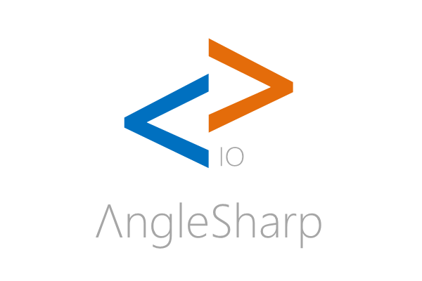

# AngleSharp.Io

[](https://github.com/AngleSharp/AngleSharp.Io/actions/workflows/ci.yml)
[](https://github.com/AngleSharp/AngleSharp.Io/releases)
[](https://www.nuget.org/packages/AngleSharp.Io/)
[](https://github.com/AngleSharp/AngleSharp.Io/issues)
[](https://cla-assistant.io/AngleSharp/AngleSharp.Io)

AngleSharp.Io extends AngleSharp with powerful requesters, caching mechanisms, and storage systems. It is coupled more strongly to the underlying operating system than AngleSharp itself. Therefore it has stronger dependencies and demands and cannot be released for the standard framework (4.6). Nevertheless, it is released as a .NET Standard 2.0 library.

## Basic Configuration

### All-In-One Setup

If you want to register all core AngleSharp.Io services in one step, use `WithIo` with `IoOptions`:

```cs
var options = new IoOptions
{
    // optional; defaults are already provided
    Permissions = new PermissionPolicy(),
    ClipboardPlatform = myClipboardPlatform,
    GeolocationPlatform = myGeolocationPlatform,
    StorageManagerPlatform = myStorageManagerPlatform,
    ServiceWorkerPlatform = myServiceWorkerPlatform,
    WebRtcPlatform = new LoopbackRtcPlatform(),
    NotificationPlatform = myNotificationPlatform,
    FileSystemPlatform = myFileSystemPlatform,
    SyncPlatform = mySyncPlatform,
    PushPlatform = myPushPlatform,
};

var config = Configuration.Default
    .WithIo(options)
    .WithDefaultLoader();
```

`WithIo` wires navigator, cookies, requesters, storage, IndexedDB, and cache in one call.
Clipboard, geolocation, the storage manager, service workers, WebRTC, notifications, the file system
access, background sync, and push are only enabled when platforms are provided.
The [permissions](#permissions) are only checked when a policy is provided.

To keep all browsing data in one place, start from `IoOptions.CreateTemporary()` (memory only) or
`IoOptions.CreatePersistent(rootDirectory)`, which stores the cookies (`cookies.txt`), the local
storage (`storage`), and the HTTP cache (`http-cache`) below the given directory. Both enable the
HTTP cache; a plain `new IoOptions()` leaves it off.

### Requesters

If you just want to use *all* available requesters provided by AngleSharp.Io you can do the following:

```cs
var config = Configuration.Default
    .WithRequesters() // from AngleSharp.Io
    .WithDefaultLoader(); // from AngleSharp
```

This will register all requesters. Alternatively, the requesters can be provided explicitly. They are located in the `AngleSharp.Io.Network` namespace and have names such as `DataRequester`.

Requesters can make use of `HttpClientHandler` instances. Hence using it, e.g., with a proxy is as simple as the following snippet:

```cs
var handler = new HttpClientHandler
{
    Proxy = new WebProxy(myProxyHost, false),
    PreAuthenticate = true,
    UseDefaultCredentials = false,
};

var config = Configuration.Default
    .WithRequesters(handler) // from AngleSharp.Io with a handler config
    .WithDefaultLoader();
```

Alternatively, if you don't want to add all possible requesters, you can also just add a single requester from AngleSharp.Io:

```cs
var config = Configuration.Default
    .With(new HttpClientRequester()) // only requester
    .WithDefaultLoader();
```

In the code above we now only have a single requester - the `HttpClientRequester` coming from AngleSharp.Io. If we have an `HttpClient` already used somewhere we can actually re-use it:

```cs
var config = Configuration.Default
    .With(new HttpClientRequester(myHttpClient)) // re-using the HttpClient instance
    .WithDefaultLoader();
```

### HTTP Cache

The HTTP(S) requesters can be wrapped with a private HTTP cache following RFC 9111. Only GET
responses are stored (HEAD is answered from them), unsafe methods such as POST invalidate the
stored responses, and `Cache-Control`, `Expires`, `Vary`, `ETag`, and `Last-Modified` are respected.
Stored responses never contain `Set-Cookie`, so cookies are not applied twice. Entries are kept
per origin of the requested address.

```cs
var config = Configuration.Default
    .WithRequesters()
    .WithHttpCache() // in memory; must come after the requesters
    .WithDefaultLoader();
```

To persist the cache, pass a directory: `.WithHttpCache(cacheDirectory)`. More options are
available via `HttpCacheOptions`, e.g., `Mode = HttpCacheMode.OnlyIfCached` to replay previously
cached pages without network access. The cache is registered as `IHttpCache`, which can be used
to inspect or clear the stored responses.

### Cookies

To get improved cookie support, e.g., do

```cs
var config = Configuration.Default
    .WithTemporaryCookies(); // Uses memory cookies
```

or if you want to have persistent cookies you can use:

```cs
var syncPath = $"Environment.GetFolderPath(Environment.SpecialFolder.UserProfile)\\anglesharp.cookies";
var config = Configuration.Default
    .WithPersistentCookies(syncPath); // Uses sync cookies against the given path
```

Alternatively, the new overloads for the `WithCookies` extension method can be used.

### Storage

AngleSharp.Io provides a single storage engine with two storage modes:

- `localStorage` using persistent per-origin files
- `sessionStorage` using in-memory buckets scoped to the top-level browsing context and origin

To configure storage, create and register an `IStorageProviderFactory`:

```cs
var syncDirectoryPath = Path.Combine(Environment.GetFolderPath(Environment.SpecialFolder.UserProfile), "anglesharp.storage");
var factory = new StorageProviderFactory();

factory.EnableLocalStorage(syncDirectoryPath);
factory.EnableSessionStorage();

var config = Configuration.Default.WithStorageProviderFactory(factory);
```

Once configured, storage services can be resolved from the browsing context:

```cs
var context = BrowsingContext.New(config);
var document = await context.OpenAsync("https://example.org");
var localStorage = document.DefaultView.LocalStorage();
var sessionStorage = document.DefaultView.SessionStorage();

localStorage["token"] = "abc";
sessionStorage["ephemeral"] = "42";
```

### IndexedDB

AngleSharp.Io provides an in-memory IndexedDB surface that is shared per origin:

- `indexedDB` using in-memory databases and object stores scoped to the origin
- versioned open with upgrade callback support
- explicit transactions (`ReadOnly` / `ReadWrite`) with commit and abort
- request-style open wrappers (`OpenRequest(...)`)
- object store record methods (`Add`, `Put`, `Get`, `Delete`, `Count`)
- key-range queries (`IndexedDbKeyRange`)
- indexes with optional uniqueness (`CreateIndex`, `GetIndex`, `DeleteIndex`)
- cursors for store and index iteration (`OpenCursor`)
- request state (`Pending` / `Success` / `Error` / `Blocked`) and close lifecycle
- version-change notifications on open connections
- optional auto-unblock open requests (`OpenRequest(..., waitForUnblock: true)`)
- request-based delete with optional auto-unblock (`DeleteDatabaseRequest(..., waitForUnblock: true)`)
- transaction lifecycle state/events (`IsCompleted`, `IsAborted`, `Completed`, `Aborted`)
- single active read-write transaction per database

To configure IndexedDB, create and register an `IIndexedDbProviderFactory`:

```cs
var factory = new IndexedDbProviderFactory();
var config = Configuration.Default.WithIndexedDbProviderFactory(factory);
```

Once configured, IndexedDB services can be resolved from the browsing context:

```cs
var context = BrowsingContext.New(config);
var document = await context.OpenAsync("https://example.org");
var database = document.DefaultView.IndexedDb().Open("app", 1, tx =>
{
    tx.CreateObjectStore("records");
});

using (var transaction = database.BeginTransaction("records", IndexedDbTransactionMode.ReadWrite))
{
    var store = transaction.GetObjectStore("records");
    var byType = store.CreateIndex("byType", "type");

    store.Add("token", "abc");
    store.Put("token", "updated");

    var notes = byType.GetAll("note");
    var range = store.GetAll(IndexedDbKeyRange.Bound("a", "m"));

    transaction.Commit();
}

var openRequest = document.DefaultView.IndexedDb().OpenRequest("app", 2, tx =>
{
    tx.CreateObjectStore("events");
});

var upgraded = await openRequest.WaitAsync();

var cursor = byType.OpenCursor(IndexedDbKeyRange.Bound("note", "task"));

while (cursor != null)
{
    Console.WriteLine(cursor.Value);
    cursor = cursor.Continue();
}

database.Close();

var waitingRequest = document.DefaultView.IndexedDb().OpenRequest(
    "app",
    3,
    tx => tx.CreateObjectStore("logs"),
    waitForUnblock: true);

var upgradedAgain = await waitingRequest.WaitAsync();

var deleteRequest = document.DefaultView.IndexedDb().DeleteDatabaseRequest("app", waitForUnblock: true);
var deleted = await deleteRequest.WaitAsync();

using (var writeTx = upgradedAgain.BeginTransaction("records", IndexedDbTransactionMode.ReadWrite))
{
    writeTx.Completed += () => Console.WriteLine("transaction committed");
    writeTx.Aborted += () => Console.WriteLine("transaction aborted");
    writeTx.GetObjectStore("records").Put("k", "v");
    writeTx.Commit();
}
```

### Cache Storage

AngleSharp.Io also exposes a lightweight Cache Storage surface that is shared per origin:

- `caches` using in-memory caches and response snapshots scoped to the origin

To configure Cache Storage, create and register an `ICacheProviderFactory`:

```cs
var factory = new CacheProviderFactory();
var config = Configuration.Default.WithCacheProviderFactory(factory);
```

Once configured, caches can be resolved from the browsing context:

```cs
var context = BrowsingContext.New(config);
var document = await context.OpenAsync("https://example.org");
var cache = document.DefaultView.Caches().Open("app");

cache.Put("https://example.org/data", new DefaultResponse());
```

### BroadcastChannel

AngleSharp.Io also provides a lightweight BroadcastChannel surface that is shared per origin:

- `BroadcastChannel` delivering `message` events to same-origin channels with the same name

Create a channel from a DOM window:

```cs
var context = BrowsingContext.New();
var document = await context.OpenAsync("https://example.org");

using var channel = new BroadcastChannel(document.DefaultView, "app");
channel.Message += (s, e) => Console.WriteLine(((MessageEvent)e).Data);
channel.PostMessage("hello");
```

### Web Locks

AngleSharp.Io also provides a minimal Web Locks surface that serializes requests per origin and lock name:

- `locks` using in-memory request queues scoped to the origin

Create a lock manager from a navigator implementation:

```cs
var config = Configuration.Default.WithNavigator();
var context = BrowsingContext.New(config);
var document = await context.OpenAsync("https://example.org");
var navigator = document.DefaultView.Navigator;
var locks = navigator.Locks();

await locks.Request("app", async _ =>
{
    Console.WriteLine("inside the lock");
    await Task.CompletedTask;
});
```

### Permissions

AngleSharp.Io provides `navigator.permissions` backed by a single permission policy. The same
policy decides whether the powerful features may be used, so there is one place to configure them:

- `permissions` exposing `query`, which returns a `PermissionStatus` with `name`, `state`, and `onchange`
- `clipboard.readText` / `clipboard.writeText` check `clipboard-read` / `clipboard-write`
- `geolocation.getCurrentPosition` checks `geolocation`
- `storage.persist` checks `persistent-storage` (and resolves with `false` instead of rejecting)
- `Notification` checks `notifications` (and dispatches `error` instead of rejecting)
- the file pickers and handles check `file-system-read` / `file-system-write`
- `registration.sync` / `registration.periodicSync` check `background-sync` / `periodic-background-sync`
- `registration.pushManager.subscribe` checks `push` (and `notifications` for `userVisibleOnly`)

The names in `PermissionNames` are known by default. A denied permission rejects with a `DomException`
named `NotAllowedError`.

`PermissionPolicy` keeps the states in memory. Every permission starts as `prompt`, and as no user
can answer the prompt in a headless browser, the feature is denied until you grant the permission:

```cs
var policy = new PermissionPolicy();

// for all origins; entries for a single origin take precedence
policy.Set(PermissionNames.ClipboardWrite, PermissionState.Granted);
policy.Set("https://example.com", PermissionNames.Geolocation, PermissionState.Granted);

// optional: answer prompts in place of the user, the answer is remembered for the origin
policy.PromptHandler = (origin, name) => Task.FromResult(PermissionState.Denied);

// optional: make a permission of another library known
policy.Register("local-fonts");

var config = Configuration.Default
    .WithNavigator()
    .WithPermissions(policy)
    .WithClipboard(new MyClipboardPlatform());
```

Use `new PermissionPolicy(PermissionState.Granted)` to allow everything, or implement
`IPermissionPolicy` to take the decisions from somewhere else. Without `WithPermissions` there is
no `navigator.permissions` and the features are not gated, as in previous versions.

Statuses follow later changes of the policy and dispatch `change` when their state changes:

```cs
var permissions = document.DefaultView.Navigator.Permissions();
var status = await permissions.Query(new PermissionDescriptor { Name = "geolocation" });
status.Changed += (sender, ev) => Console.WriteLine(status.State);

policy.Set("https://example.com", PermissionNames.Geolocation, PermissionState.Denied);
```

APIs from other libraries can use the same check before touching a feature:

```cs
await permissions.EnsureGrantedAsync("local-fonts"); // throws NotAllowedError if not granted
var state = await permissions.RequestAsync("local-fonts"); // granted or denied, never prompt
```

### Clipboard

AngleSharp.Io provides a navigator clipboard surface backed by a user-supplied platform implementation:

- `clipboard` exposing `readText` / `writeText`

Register a platform implementation during configuration:

```cs
public sealed class MyClipboardPlatform : IClipboardPlatform
{
    public Task<string> ReadTextAsync() => Task.FromResult("sample");

    public Task WriteTextAsync(string text) => Task.CompletedTask;
}

var config = Configuration.Default.WithClipboard(new MyClipboardPlatform());
```

To expose `navigator`, include navigator registration in the configuration:

```cs
var config = Configuration.Default
    .WithNavigator()
    .WithClipboard(new MyClipboardPlatform());
```

Resolve it from `INavigator`:

```cs
var navigator = document.DefaultView.Navigator;
var clipboard = navigator.Clipboard();

await clipboard.WriteText("hello");
var value = await clipboard.ReadText();
```

### Geolocation

AngleSharp.Io provides a navigator geolocation surface backed by a user-supplied platform implementation:

- `geolocation` exposing `getCurrentPosition`

Register a platform implementation during configuration:

```cs
public sealed class MyGeolocationPlatform : IGeolocationPlatform
{
    public Task<GeolocationReading> GetCurrentPositionAsync(GeolocationOptions options)
    {
        return Task.FromResult(new GeolocationReading
        {
            Latitude = 52.52,
            Longitude = 13.405,
            Accuracy = 8.0,
        });
    }
}

var config = Configuration.Default.WithGeolocation(new MyGeolocationPlatform());
```

To expose `navigator`, include navigator registration in the configuration:

```cs
var config = Configuration.Default
    .WithNavigator()
    .WithGeolocation(new MyGeolocationPlatform());
```

Resolve it from `INavigator`:

```cs
var navigator = document.DefaultView.Navigator;
var geolocation = navigator.Geolocation();
var position = await geolocation.GetCurrentPosition();
```

### Storage Manager

AngleSharp.Io provides `navigator.storage` backed by a user-supplied platform implementation:

- `storage` exposing `estimate`, `persist`, and `persisted`

The platform receives the origin of the active document. `MemoryStorageManagerPlatform` reports
fixed values and keeps the persistence state in memory, which makes it a good fit for tests:

```cs
var platform = new MemoryStorageManagerPlatform
{
    Quota = 1024 * 1024 * 1024,
    Usage = 4096,
    AllowPersistence = true, // the default
};

var config = Configuration.Default
    .WithNavigator()
    .WithStorageManager(platform);
```

For host-specific behavior implement `IStorageManagerPlatform` instead. Resolve it from `INavigator`:

```cs
var storage = document.DefaultView.Navigator.Storage();
var estimate = await storage.Estimate(); // estimate.Usage, estimate.Quota
var granted = await storage.Persist();
var persisted = await storage.Persisted();
```

### Notifications

AngleSharp.Io provides the `Notification` constructor with its permission flow. Delivering a
notification is up to an `INotificationPlatform`; whether it may be shown is up to the
[permission policy](#permissions), which answers `notifications` as for every other feature:

- `new Notification(title, options)` with `title`, `dir`, `lang`, `body`, `tag`, `image`, `icon`, `badge`,
  `timestamp`, `renotify`, `silent`, `requireInteraction`, `data`, `close`, and the `show`, `error`,
  `click`, and `close` events
- `Notification.GetPermission(window)` / `Notification.RequestPermission(window)`, i.e., the static
  `permission` and `requestPermission`, giving `default`, `granted`, or `denied`

The included `NotificationPlatform` delegates to optional callbacks. It reports what the user does
via `NotifyClicked` and `NotifyClosed` on the notification:

```cs
var policy = new PermissionPolicy
{
    // stands in for the user; the answer is remembered for the origin
    PromptHandler = (origin, name) => Task.FromResult(PermissionState.Granted),
};

var platform = new NotificationPlatform
{
    Show = notification => MyDesktop.ShowAsync(notification.Title, notification.Body, notification.NotifyClicked),
    Close = notification => MyDesktop.RemoveAsync(notification.Tag),
};

var config = Configuration.Default
    .WithPermissions(policy)
    .WithNotifications(platform);
```

```cs
var window = document.DefaultView;
var permission = await Notification.RequestPermission(window); // NotificationPermission.Granted
var notification = new Notification(window, "Hello", new NotificationOptions { Body = "World" });
var shown = await notification.Delivery;                       // true once the platform showed it
notification.Close();
```

As in browsers, constructing a notification without the permission does not throw and does not
prompt: nothing reaches the platform and the `error` event is dispatched. A dismissed prompt leaves
the permission at `default`. Without `WithPermissions` notifications are not gated, and without a
platform the constructor throws a `NotSupportedError`. Events are dispatched in tasks of the
context's event loop; without an event loop they are dispatched on a background thread, so use
`Delivery` to learn about the outcome reliably. Replacing notifications with the same `tag` and
displaying anything are up to the platform; `actions` and notifications on service worker
registrations are not supported.

### File System Access

AngleSharp.Io provides a subset of the File System Access API, where the pickers and all access to
the files go through an `IFileSystemPlatform`:

- `window.showOpenFilePicker` (`multiple`, `types`, `excludeAcceptAllOption`, `id`, `startIn`) and
  `window.showSaveFilePicker` (additionally `suggestedName`)
- `FileSystemFileHandle` with `kind`, `name`, `isSameEntry`, `queryPermission`, `requestPermission`,
  `getFile`, and `createWritable` (with `keepExistingData`)
- `FileSystemWritableFileStream` with `write` (strings, bytes, blobs, or `WriteParams`), `seek`,
  `truncate`, `close`, and `abort`

`MemoryFileSystemPlatform` keeps the files in memory for deterministic tests. For anything else
implement `IFileSystemPlatform`:

```cs
var platform = new MemoryFileSystemPlatform();
platform.SetFile("notes.txt", Encoding.UTF8.GetBytes("Hello"), "text/plain");
platform.OpenFilePicker = options => new[] { "notes.txt" }; // stands in for the user
platform.SaveFilePicker = options => options.SuggestedName; // null dismisses the picker

var config = Configuration.Default.WithFileSystemAccess(platform);
```

```cs
var window = document.DefaultView;
var handle = (await window.ShowOpenFilePicker())[0];
var file = await handle.GetFile();

var stream = await handle.CreateWritable();
await stream.Write("World");
await stream.Close();                                          // replaces the content of the file
```

All writes go to a buffer that replaces the file on `close`, so the file stays untouched if the
stream is aborted or the platform fails, given that its `WriteFileAsync` is atomic. Dismissing a
picker rejects with an `AbortError`. Handles to the same file are different objects, which
`isSameEntry` recognizes by the `Id` of the platform's `FileSystemEntry`.

The [permission policy](#permissions) is asked for `file-system-read` and `file-system-write`, where
write access includes reading; browsers express this as the mode of a single `file-system`
permission. A denied permission rejects with a `NotAllowedError`, also for a stream that is already
open. The pickers require a secure context, which can be turned off:

```cs
var options = new FileSystemAccessOptions { RequireSecureContext = false };
var config = Configuration.Default.WithFileSystemAccess(platform, options);
```

Directory handles and the origin private file system are not supported. Transient user activation is
not required as there is no user.

### Service Workers

AngleSharp.Io provides `navigator.serviceWorker` with a minimal registration surface:

- `serviceWorker` exposing `register` (with `scope`, `type`, and `updateViaCache`), `getRegistration`,
  `getRegistrations`, `ready`, `controller`, and the `controllerchange` and `message` events
- registrations exposing `scope`, `updateViaCache`, `installing`, `waiting`, `active`, `update`,
  `unregister`, and the `updatefound` event
- workers exposing `scriptURL`, `state`, `postMessage`, and the `statechange` event

As in browsers, `navigator.serviceWorker` is only available in secure contexts, i.e., for `https`
documents and for `http` documents served from `localhost` or a loopback address.

Running the worker script is up to an `IServiceWorkerPlatform`. The included `ServiceWorkerPlatform`
delegates to optional callbacks; without callbacks every worker installs and activates and all
requests go to the network:

```cs
var platform = new ServiceWorkerPlatform
{
    Install = worker => Task.CompletedTask,      // a faulted task makes the worker redundant
    CheckForUpdate = worker => Task.FromResult(false), // true installs a new worker
    Message = (worker, message) => { },          // receives worker.postMessage(...)
    Fetch = (worker, request, cancel) =>
    {
        // return null to continue with the network
        var response = VirtualResponse.Create(res => res.Address(request.Address).Content("offline"));
        return Task.FromResult(response);
    },
};

var config = Configuration.Default
    .WithNavigator()
    .WithRequesters()
    .WithServiceWorkers(platform) // after WithRequesters
    .WithDefaultLoader();
```

`WithServiceWorkers` wraps the registered HTTP(S) requesters, so it must be called after
`WithRequesters`. Requests (including navigations and `fetch`) whose URL lies within the scope of
an active worker are passed to the platform first; the HTTP cache, if any, stays behind the worker.

```cs
var container = document.DefaultView.Navigator.ServiceWorker();
var registration = await container.Register("/app/sw.js"); // scope defaults to /app/
var state = registration.Active.State;                       // ServiceWorkerState.Activated
var ready = await container.Ready;                           // registration controlling the document
await registration.Update();                                 // asks the platform's CheckForUpdate
```

Workers reply to documents via the registry, which dispatches a `message` event on the containers
of the documents they control:

```cs
var registry = context.GetService<ServiceWorkerRegistry>();
registry.PostMessageToClients(registration.Active, "hello");
```

Compared to browsers the lifecycle is simplified: `register` and `update` complete once the worker
is activated (or redundant if its installation failed), new workers are activated right away as if
`skipWaiting()` was called, and `unregister` drops the workers immediately. Since scripts are not
fetched, the platform decides whether a script changed (`CheckForUpdate`) and the scope cannot be
wider than the script's directory. Requests are matched by their own URL and the controller is
determined on access, as clients are not tracked.

### Background Sync

AngleSharp.Io exposes the managers for deferred work on service worker registrations. An
`ISyncPlatform` decides when tasks run and runs them in the worker, so tests stay deterministic:

- `registration.sync` with `register` and `getTags`, where a tag is removed once its task succeeded
  or ran out of attempts (three, the last one with `LastChance`)
- `registration.periodicSync` with `register` (with `minInterval`), `getTags`, and `unregister`

The platform receives a `SyncTask` when it should plan a firing and calls `FireAsync` when it is time.
The included `SyncPlatform` delegates to optional callbacks; without them tasks only fire when you
call `FireAsync`:

```cs
var tasks = new List<SyncTask>();
var platform = new SyncPlatform
{
    Schedule = task => { tasks.Add(task); return Task.CompletedTask; },
    Cancel = task => { tasks.Remove(task); return Task.CompletedTask; },
    Dispatch = (worker, task) => MyWorkerHost.RunAsync(worker, task.Tag), // a faulted task is a failure
};

var config = Configuration.Default
    .WithNavigator()
    .WithRequesters()
    .WithServiceWorkers()
    .WithBackgroundSync(platform);
```

```cs
var registration = await container.Register("/app/sw.js");
await registration.Sync.Register("outbox");
await registration.PeriodicSync.Register("news", new BackgroundSyncOptions { MinInterval = 3600000 });

await tasks[0].FireAsync(); // true if the event was handled successfully
```

Registering a known tag does not add a second task: a one-off task being fired fires once more
afterwards, and a periodic task picks up a changed `minInterval`. Periodic tasks and one-off tasks to
retry are passed to `ScheduleAsync` again after firing, while `unregister` and removing the service
worker registration end up in `CancelAsync`. `SyncManager.Unregister` also exists for hosts, but as it
is not part of the specification it is not exposed to scripts.

The tasks require an active worker (otherwise rejecting with an `InvalidStateError`) and a secure
origin. The [permission policy](#permissions) is asked for `background-sync` and
`periodic-background-sync` for the origin of the registration. Compared to browsers, the
`InvalidAccessError` for registering without an open page does not exist as clients are not tracked.

### Push

AngleSharp.Io provides `registration.pushManager` with the subscription lifecycle. An `IPushPlatform`
talks to the push service and delivers messages to the worker:

- `pushManager` with `subscribe` (with `userVisibleOnly` and `applicationServerKey`), `getSubscription`,
  and `permissionState`
- subscriptions with `endpoint`, `expirationTime`, `options`, `getKey`, `toJSON`, and `unsubscribe`
- `PushMessageData` with `text`, `json`, `arrayBuffer`, `bytes`, and `blob` for the payload

The included `PushPlatform` delegates to optional callbacks. Without them no push service is involved
and subscriptions get a generated endpoint below `https://push.invalid/`, which is enough for testing
the lifecycle:

```cs
var platform = new PushPlatform
{
    Subscribe = (origin, scope, options) => MyPushService.SubscribeAsync(origin, scope, options),
    Unsubscribe = subscription => MyPushService.UnsubscribeAsync(subscription.Endpoint),
    Dispatch = (worker, data) => MyWorkerHost.PushAsync(worker, data?.Text()),
};

var config = Configuration.Default
    .WithNavigator()
    .WithRequesters()
    .WithServiceWorkers()
    .WithPush(platform);
```

```cs
var registration = await container.Register("/app/sw.js");
var subscription = await registration.PushManager.Subscribe(new PushSubscriptionOptionsInit
{
    UserVisibleOnly = true,
    ApplicationServerKey = myBase64UrlKey,
});

// when a message arrives; decrypting it (aes128gcm) is up to the host
var registry = context.GetService<ServiceWorkerRegistry>();
await registry.DeliverPushAsync(subscription.Endpoint, decryptedPayload);
```

A subscription belongs to its registration and hence to its origin, and it is removed with the
registration. Subscribing again returns the subscription, unless the options differ, which rejects
with an `InvalidStateError`. A failing `SubscribeAsync` rejects with an `AbortError`, unless it is
faulted with a `DomException`, which is passed on. As in the specification, `unsubscribe` deactivates
the subscription even if `UnsubscribeAsync` fails, so retrying is up to the platform. The form of the
`applicationServerKey` is validated, but not whether it lies on the curve.

The [permission policy](#permissions) is asked for `push` and, for `userVisibleOnly` subscriptions,
for `notifications` as well, as their messages have to end in a notification. A denied permission
rejects with a `NotAllowedError` without involving the platform. The `pushsubscriptionchange` event
is not supported.

### Using the APIs from Scripts

Everything above is available from .NET. To use these APIs from scripts, which includes the static
members `Notification.permission` and `Notification.requestPermission`, the `types` of the file
pickers, and buffers for `write` and `applicationServerKey`, *AngleSharp.Js* 1.1.5 or later is needed.

### Beacon

AngleSharp.Io provides `navigator.sendBeacon` for fire-and-forget requests, e.g., for telemetry:

- `sendBeacon(url, data)` queues a `POST` request and returns right away

The data can be a string (sent as `text/plain;charset=UTF-8`), a blob (sent with its type), a byte
array or `ArraySegment<Byte>`, `FormDataSet` (sent as `multipart/form-data`), or `UrlSearchParams`
(sent as `application/x-www-form-urlencoded`). The request goes through the configured
`IDocumentLoader`, i.e., the requesters and cookies apply as for `fetch`.

```cs
var config = Configuration.Default
    .WithNavigator()
    .WithRequesters()
    .WithDefaultLoader();

var navigator = document.DefaultView.Navigator;
var queued = navigator.SendBeacon("/collect", "session ended");
```

`SendBeacon` returns `false` if the beacon was not queued: when no loader is registered, when the
data is not supported (e.g., a `Stream`, whose length is unknown upfront) or cannot be serialized,
or when the body would exceed the quota. As in browsers, the bodies of the pending beacons may not
exceed 64 KiB per browsing context. Once queued, failures (e.g., network errors) are not reported,
but release the quota. Beacons keep going when their document navigates away, closes, or its
browsing context is disposed.

`BeaconOptions` changes the quota and can limit the number of beacons sent at the same time; further
beacons are queued, count towards the quota, and are sent in order:

```cs
var config = Configuration.Default
    .WithNavigator()
    .WithRequesters()
    .WithDefaultLoader()
    .WithBeacon(new BeaconOptions
    {
        Quota = 256 * 1024,
        MaxConcurrentRequests = 4, // 0 (default) sends all right away
    });
```

Beacons carry an `Origin` header. Like in browsers, a beacon to another origin whose content type is
not `text/plain`, `application/x-www-form-urlencoded`, or `multipart/form-data` (e.g., a JSON blob)
is preceded by a CORS preflight (`OPTIONS`, without cookies). The beacon is only sent if the response
allows the origin (`Access-Control-Allow-Origin` with the exact origin), credentials
(`Access-Control-Allow-Credentials: true`), and the `content-type` header
(`Access-Control-Allow-Headers`). Preflight results are not cached.

An invalid or non-HTTP(S) URL throws an `InvalidOperationException`, standing in for the
`TypeError` of the spec.

### Reporting

AngleSharp.Io collects browser-like diagnostics as reports, following the shape of the Reporting
API and Network Error Logging (NEL):

- `WithReporting` registers a `ReportingService` that queues reports until they are flushed
- failed requests and responses with a status of 400 or above are captured as `network-error`
  reports from the requester pipeline
- `window.QueueReport(...)` emits reports about a document, e.g., deprecations
- `ReportingObserver` exposes the reports of a window (`observe`, `disconnect`, `takeRecords`)

Flushed reports go to the configured sinks, each with an optional filter by type and endpoint:

```cs
var memory = new MemoryReportSink();
var options = new ReportingOptions()
    .AddSink(memory)
    .AddSink(new EndpointReportSink(new HttpClientRequester()), ReportFilter.ForTypes(ReportTypes.NetworkError))
    .AddSink((reports, cancel) => LogAsync(reports), ReportFilter.ForDestinations("default"));

options.Endpoints["default"] = "https://collector.example/reports";

var config = Configuration.Default
    .WithRequesters()
    .WithReporting(options) // after WithRequesters
    .WithDefaultLoader();
```

The service can be resolved from the configuration or a browsing context to enumerate, emit, and
flush the reports:

```cs
var reporting = context.GetService<ReportingService>();
var errors = reporting.GetReports(ReportFilter.ForTypes(ReportTypes.NetworkError));
reporting.QueueReport(new Report("custom", "https://example.org/", new GenericReportBody(members)));
await reporting.FlushAsync(); // removes the queued reports and hands them to the sinks
```

Reports serialize to JSON via `ToJson()` (`type`, `url`, `body`) and `ToDeliveryJson(now)`, the
format posted by `EndpointReportSink` as `application/reports+json` (adding `age` and `user_agent`).
A `network-error` report carries a `NetworkErrorReportBody` with the NEL members, e.g., `phase`
(`dns`, `connection`, `application`), `type` (e.g., `dns.name_not_resolved`, `tcp.refused`,
`tcp.timed_out`, `tls.failed`, `abandoned`, `http.error`), `elapsed_time`, `method`, `referrer`,
and `status_code`. Report URLs exclude credentials and fragments.

Further options:

- `Filter` decides which reports are queued at all
- `CaptureNetworkErrors` / `CaptureHttpErrors` turn the captured network errors on or off
- `NetworkErrorDestination` names the endpoint of network errors (`default` by default)
- `MaxQueueSize` limits the queue, dropping the oldest reports (1000 by default)
- `FlushInterval` flushes automatically, otherwise reports are only flushed by `FlushAsync`

Endpoint names are resolved to URLs via the `Reporting-Endpoints` header of responses from the
report's origin, falling back to `Endpoints`. The reporting sits closest to the network, i.e.,
behind the HTTP cache and service workers, so only requests reaching the network are reported.

As in browsers, a `ReportingObserver` callback runs as a task of the browsing context's event loop
(`IEventLoop`, e.g., provided by a scripting engine), receiving all reports added until the task
runs; without an event loop the callback is invoked right away.

Compared to browsers this is a lightweight subset: a flush removes the reports even if a sink fails
(the failure is rethrown), and `NEL` policy headers are not interpreted, i.e., network errors of
every origin are captured.

### WebRTC

AngleSharp.Io provides the signaling part of WebRTC via `RTCPeerConnection`, with the transport
provided by a pluggable `IRtcPlatform`:

- `createOffer`, `createAnswer`, `setLocalDescription` (also without arguments), and
  `setRemoteDescription`, including provisional answers and (implicit) rollbacks
- `addIceCandidate`, `restartIce`, `getConfiguration`, `setConfiguration`, and `close`
- the `signalingState`, `iceGatheringState`, `iceConnectionState`, and `connectionState`
  attributes with their change events, plus `negotiationneeded` and `icecandidate`
- `createDataChannel` with `RTCDataChannel` (`send`, `close`, and the `open`, `message`,
  `closing`, `close` events) and the `datachannel` event

`WithWebRtc()` registers the `LoopbackRtcPlatform`, which connects the peer connections of the
configuration with each other in-process: its SDP is deterministic, each peer gathers a single host
candidate on 127.0.0.1, and a peer connects once both descriptions are applied and it received a
candidate of the other peer. Data channel messages are delivered between the connected peers.

```cs
var config = Configuration.Default.WithWebRtc();
var context = BrowsingContext.New(config);
var document = await context.OpenAsync("https://example.org");

var caller = new RtcPeerConnection(document.DefaultView);
var callee = new RtcPeerConnection(document.DefaultView);
var channel = caller.CreateDataChannel("chat");

var offer = await caller.CreateOffer();
await caller.SetLocalDescription(offer);
await callee.SetRemoteDescription(offer);
var answer = await callee.CreateAnswer();
await callee.SetLocalDescription(answer);
await caller.SetRemoteDescription(answer);
// then exchange the candidates of the icecandidate events via addIceCandidate
```

A custom `IRtcPlatform` (e.g., backed by a WebRTC stack or a test double) creates an `IRtcPeer` per
connection, which produces the SDP, applies the descriptions, and reports candidates, state changes,
and data channel events through the given `IRtcPeerHost`. Without a registered platform,
constructing an `RTCPeerConnection` from a window fails with `NotSupportedError`; the constructor
taking an `IRtcPlatform` works without any configuration.

As in browsers, the events of the transport (candidates, ICE states, data channels) are dispatched as
tasks of the browsing context's event loop. Without an event loop they are dispatched once the
running operation completed, i.e., always after the state change they belong to. Media (tracks,
transceivers, codecs) and statistics are not supported; data channels deliver messages in order
without modeling the reliability parameters, and binary messages are always byte arrays.

### Fetch

AngleSharp.Io also exposes a `fetch` method on `window`:

- `fetch` delegates to the configured `IDocumentLoader`

Configure requesters and a default loader:

```cs
var config = Configuration.Default
    .WithRequesters()
    .WithDefaultLoader();
```

Use fetch from a DOM window:

```cs
var context = BrowsingContext.New(config);
var document = await context.OpenAsync("https://example.org");

var response = await document.DefaultView.Fetch("/api/data", new FetchOptions
{
    Method = "POST",
    Headers = new Dictionary<string, string>
    {
        ["X-Requested-With"] = "AngleSharp.Io"
    },
    Body = "payload"
});
```

### Downloads

AngleSharp.Io offers you the possibility of a simplified downloading experience. Just use `WithStandardDownload` to redirect resources to a callback.

In the simplest case you can write:

```cs
var config = Configuration.Default
    .WithStandardDownload((fileName, content) =>
    {
        // store fileName with the content stream ...
    });
```

Alternatively, use `WithDownload`, which allows you to distinguish also on the provided MIME type.

## DOM Extension Methods

The `IHtmlInputElement` interface now has `AppendFile` to easily allow appending files without much trouble.

```cs
document
    .QuerySelector<IHtmlInputElement>("input[type=file]")
    .AppendFile("c:\\example.jpg");
```

More overloads exist.

Furthermore, the `IUrlUtilities` interface now has `DownloadAsync`.

```cs
document
    .QuerySelector<IHtmlAnchorElement>("a#download-document")
    .DownloadAsync()
    .SaveToAsync("c:\\example.pdf");
```

The `SaveToAsync` (as well as the `CopyToAsync`) are extension methods for the `IResponse` interface.

## Features

- New requesters
  - HTTP (using `HttpClient`)
  - FTP
  - Supporting data URLs
  - Supporting file URLs
  - Enhanced support for about: URLs
- WebSockets (mostly interesting for scripting engines, e.g., JS)
- Storage support with a unified `Storage` implementation
- Improved cookie container (`AdvancedCookieContainer`)
- Private HTTP cache for the requesters (memory or persisted)
- Enhanced download capabilities for resources / links
- Web Locks support for origin-scoped request serialization
- Permissions (`navigator.permissions`) with one injectable policy gating the powerful features
- Clipboard support with injectable platform implementation
- Geolocation support with injectable platform implementation
- Storage manager (`navigator.storage`) support with injectable platform implementation
- Service worker registrations (`navigator.serviceWorker`) with request interception
- Beacon support (`navigator.sendBeacon`) for fire-and-forget requests
- Reporting of network errors and other diagnostics with injectable sinks
- WebRTC signaling (`RTCPeerConnection`) with data channels and a pluggable transport

## Participating

Participation in the project is highly welcome. For this project the same rules as for the AngleSharp core project may be applied.

If you have any question, concern, or spot an issue then please report it before opening a pull request. An initial discussion is appreciated regardless of the nature of the problem.

Live discussions can take place in our [Gitter chat](https://gitter.im/AngleSharp/AngleSharp), which supports using GitHub accounts.

This project has adopted the code of conduct defined by the Contributor Covenant to clarify expected behavior in our community.

For more information see the [.NET Foundation Code of Conduct](https://dotnetfoundation.org/code-of-conduct).

## .NET Foundation

This project is supported by the [.NET Foundation](https://dotnetfoundation.org).

## License

AngleSharp.Io is released using the MIT license. For more information see the [license file](./LICENSE).
